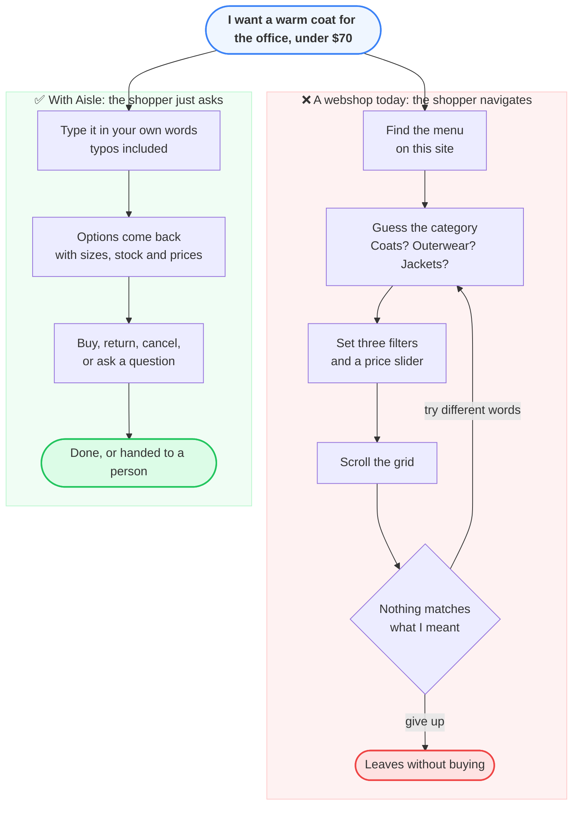
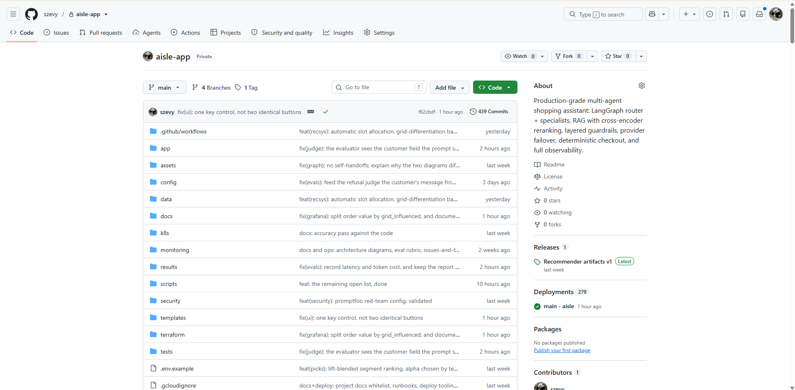
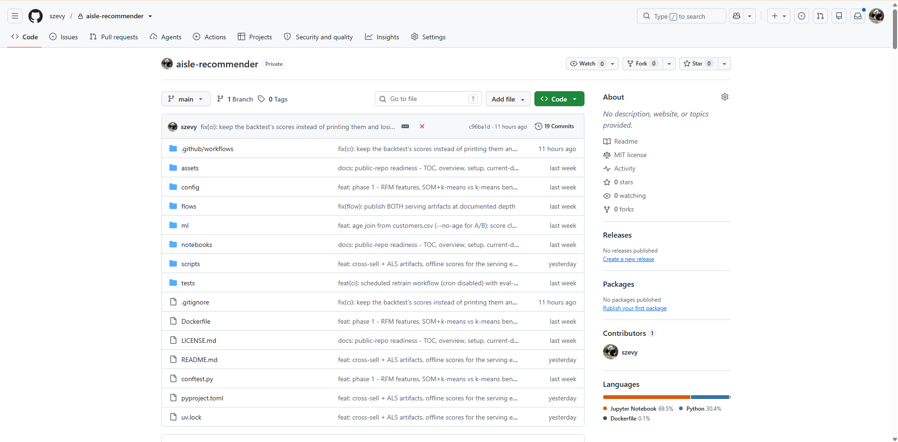

# Aisle, an agentic shopping assistant

### 📌 Repository scope

This is the **public demo/integration repository** for Aisle. The underlying serving components and recommender pipeline are maintained in separate private repositories, as explained below.

**▶ Try it live:** https://aisle-4fpi.onrender.com
*(Free tier: The application sleeps when idle and re-fetches ~400 MB of data on wake. The initial request may take several minutes.)*

  

  Full tour at 1.5x speed: <a href="media/demo.mp4">media/demo.mp4</a> 
  The scripted recording regenerates automatically when the UI changes. It is unedited and unstaged.

> **The segment label and its seven features are displayed for review purposes only.** A production deployment would use this segment to personalize the storefront without exposing the label to the customer. All other elements are functional features: per-size stock tracking indicates size availability, and the **Not right?** and **Too slow?** buttons collect feedback to train the classifier.

---

## Contents

Recommended reading order: features, architecture, constraints, evaluation, and deployment.

| Section | What is in it |
|---|---|
| **[What Aisle does](docs/features.md)** | Core shopping features, post-sale workflows, and recommendations with application screenshots. |
| **[How Aisle is built](docs/architecture.md)** | Agent graph design, single-turn execution flow, and customer segmentation. |
| **[Guardrails](docs/guardrails.md)** | Input validation and output safety checks. |
| **[Structured output enforcement](docs/structured-output.md)** | Schema enforcement for model decisions and error-handling strategies. |
| **[Security](docs/security.md)** | Authentication, data isolation, secret management, and identified vulnerabilities. |
| **[Reliability](docs/reliability.md)** | LLM provider failover, circuit breakers, and dependency degradation strategies. |
| **[Evaluation](docs/evaluation.md)** | Offline evaluation suite, retrieval metrics, latency, cost, and online LLM judges. |
| **[Observability](docs/observability.md)** | Metrics, traces, dashboards, alerts, and threshold justifications. |
| **[Token economics](docs/token-economics.md)** | Token consumption, API call metrics per request, and budget caps. |
| **[Deployment and operations](docs/operations.md)** | Infrastructure as code and deployment architecture. |

---

## The problem

Traditional e-commerce interfaces impose high cognitive load on users:

- **Inconsistent layouts:** Users must learn unique navigation, menu, and checkout structures for every online store.
- **Inflexible filtering:** Complex, natural-language queries like "a warm coat for the office under $70" cannot be accurately mapped to standard UI dropdowns and price sliders.
- **Accessibility barriers:** Complex category trees exclude users who find traditional web navigation challenging.

The following comparison illustrates the difference between a standard webshop and an assistant-guided experience:

In physical retail, sales assistants resolve these friction points by processing natural language requests, checking inventory, managing returns, and escalating complex issues.

**Aisle brings this conversational assistance to e-commerce.** A single chat interface replaces traditional navigation, allowing customers to shop using natural language.

## What counts as working

The project success is measured by four key performance indicators:

| Claim | Measured by | Where |
|---|---|---|
| Accurate request routing | Intent classification and routing accuracy on a golden dataset | [evaluation](docs/evaluation.md) |
| Grounded, non-hallucinated answers | Faithfulness, context precision, and context recall | [evaluation](docs/evaluation.md) |
| Personalized product recommendations | Number of distinct products across segment grids and worst pairwise overlap | [features](docs/features.md) |
| Free-tier resource compliance | API calls and tokens per request against a target of 6 calls and 10,000 tokens | [token economics](docs/token-economics.md) |

Two primary constraints guide the system design:
1. **Resource limits:** The application runs on free-tier infrastructure with 512 MB of memory and metered API quotas.
2. **Transactional integrity:** Classification errors must not result in incorrect financial charges, invalid inventory allocation, or unauthorized returns.

Anomalies trigger immediate Slack alerts rather than remaining unmonitored on dashboards.

---

## What the recommender optimises for

Standard recommendation engines predict purchase probability. This approach often counts baseline purchases as successes, even if the customer intended to buy the item regardless. This limitation is documented in offline evaluation research ([RecSys 2019](https://dl.acm.org/doi/abs/10.1145/3298689.3347018)).

Aisle optimizes for **incremental basket value** (items added beyond the customer's initial intent) through two design choices:

- **Diversity-focused ranking:** The system serves four customer segments, each presented with a grid of eight products drawn from a catalogue of 105,542 articles. The product overlap between the two most similar segments is measured on every retrain, because a model that collapses all segments onto the same bestsellers will score highly on prediction accuracy while failing to provide distinct recommendations. Consequently, recall@8 is maintained as a performance floor rather than the primary objective.
- **Dynamic voucher thresholds:** Minimum spend requirements are calculated dynamically based on the customer's average order value. This ensures incentives are both achievable and effective at increasing order size, avoiding the inefficiencies of flat thresholds.

For details on the methodology, baselines, and the nine evaluated strategies, see [the evaluation page](docs/evaluation.md).

---

## The source

The code lives in two private repositories; this page is the public face.

**aisle-app** (private) is the assistant
itself: the FastAPI service, the LangGraph agents, retrieval, guardrails, the
evaluation suites, and the Terraform for the metrics stack. 439 commits, 279
deployments to the live site above.

**aisle-recommender** (private) is
the recommender workbench: RFM features, SOM and k-means segmentation benchmarks, the
ALS cross-sell backtests, and the scheduled retrain workflow. Its output ships to the
assistant as versioned artifacts (the app repo's "Recommender artifacts v1" release),
so the model work and the serving app stay separate.

## Built with

**LangGraph** · **Pinecone** · **LangChain** · **FastAPI** · **Redis** · **Terraform** ·
**Docker** · **Prometheus** · **Grafana** · **Langfuse** · **Presidio**
· **scikit-learn** · **Stripe** (test mode)

LLM providers configured in a failover chain: **Cerebras**, **Groq**, **Mistral**, **Google**.
Deployed on Render.

---

© 2026 Tan Sze Vy (@szevy). All rights reserved. See [LICENSE](LICENSE).

**Demo data attribution:** Product catalogue data is sourced from **H&M Group** via the
[Kaggle H&M Personalized Fashion Recommendations competition](https://www.kaggle.com/competitions/h-and-m-personalized-fashion-recommendations)
and used as sample data. The "Aisle" assistant is an independent portfolio demonstration and is
**not affiliated with or endorsed by H&M**.