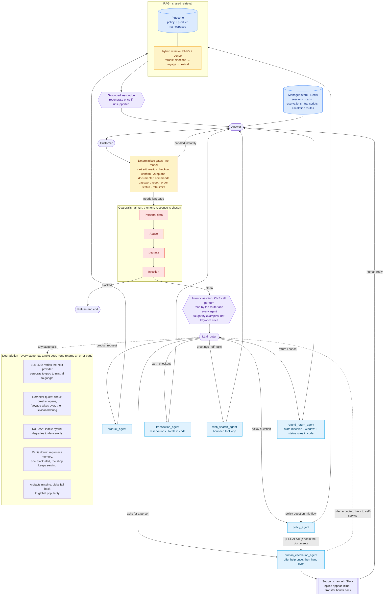
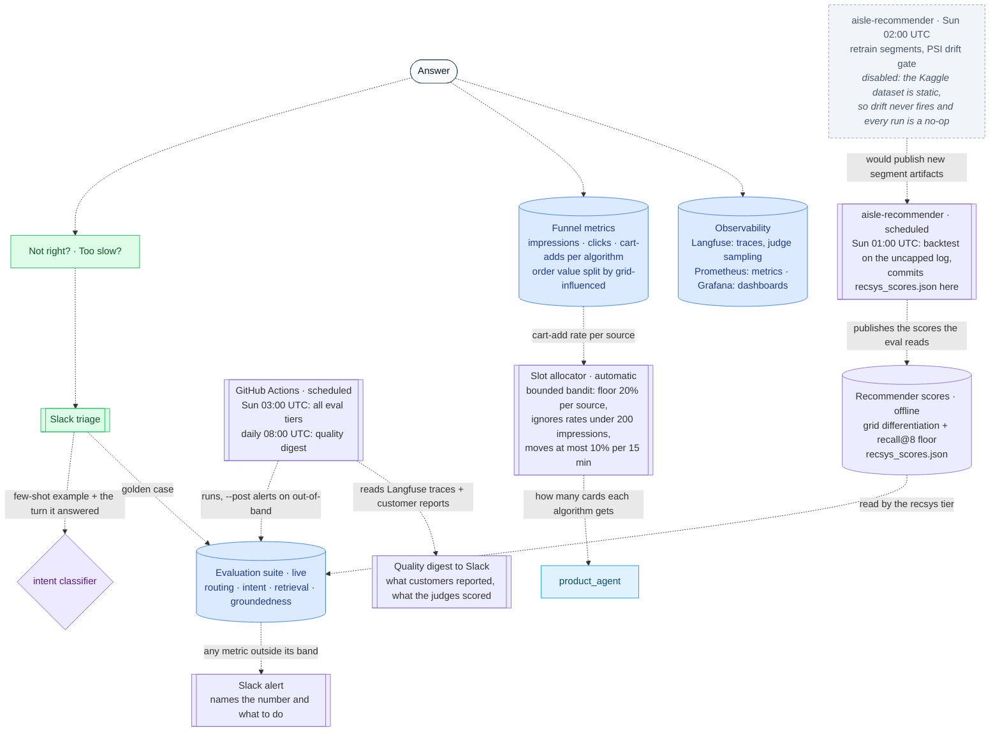
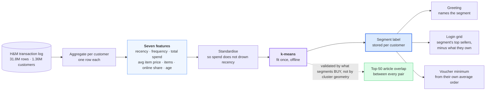

# How Aisle is built

### How the system improves itself

The system uses feedback loops to monitor performance, trigger alerts, and reallocate resources without manual code changes.

The recommender is scored on grid differentiation rather than prediction accuracy. Two
figures are recorded: how many distinct products appear across the four segment grids,
and the overlap between the two most similar segments. Recall@8 is retained as a floor
rather than the objective, because it rewards predicting purchases that would have
happened without a recommendation. The training repository computes both and publishes
them as `recsys_scores.json`, which the weekly evaluation reads.

## The agentic workflow

### Core architectural principle: separation of model and code

The codebase separates deterministic logic from language model interpretation.

**Intent versus action.** The language model identifies user intent, while deterministic code executes the action. Misclassification routes a request to the wrong handler but cannot exceed the handler's explicit permissions.

**Deterministic responsibilities.** Business logic, security, and data integrity reside in code: command execution, checkout confirmation, cart arithmetic, stock reservations, and personal-data detection.

**Model responsibilities.** The model performs semantic interpretation, such as identifying return requests or product search queries. Linguistic variation is managed through prompt examples.

**Structured output enforcement.** Model decisions affecting control flow are constrained to a pydantic schema. The handler receives a validated object. See [Structured output enforcement](structured-output.md) for the four schemas, error handling, and router validation logic.

---

## Customer segmentation

The greeting, login grid, and voucher are determined by the customer's transaction history.

Segmentation is computed offline and periodically. Login reads the stored label, ensuring no latency for the user.

**Seven features per customer**, computed from the H&M transaction log:

| Feature | What it is |
|---|---|
| Days since last order | Recency |
| Orders placed | Frequency |
| Total spend | Monetary value |
| Average item price | Price sensitivity |
| Items bought | Basket size over time |
| Bought online | Share of online versus in-store orders |
| Age | From the customer record |

This includes the RFM trio (recency, frequency, monetary) plus four features to distinguish between customers with similar spend but different purchasing habits.

**k-means clustering**, fit once and applied at login. This is an unsupervised model as no ground-truth labels exist.

**Cluster evaluation.** Silhouette scores (0.25 at k=2, 0.21 at k=4) and Davies-Bouldin scores are low. These metrics assume data exists as separated blobs. Shopping behavior is a continuum, so partitions naturally score poorly. These metrics describe the data distribution rather than model quality.

Testing 20x more training data (68,185 to 1,362,281 customers), 73 additional product-taste features, and a self-organizing map did not improve silhouette scores.

**Validation.** The model is validated by measuring whether segments purchase different items. Overlap between each pair's 50 most-bought articles:

| Segment pair | Shared articles in top 50 | Overlap |
|---|---|---|
| 0 vs 1 | 1 | 2% |
| 1 vs 3 | 7 | 14% |
| 0 vs 3 | 9 | 18% |
| 1 vs 2 | 12 | 24% |
| 0 vs 2 | 14 | 28% |
| 2 vs 3 | 22 | 44% |

Four of six pairs share under 25% of their top items. Segments with low overlap receive distinct product grids.

**Implementation.** This is a demo surface. A production system would use segments to personalize content without exposing the classification to the user. The segment data is exposed here for inspection, showing the seven features against segment medians.

---

[← Back to the README](../README.md)