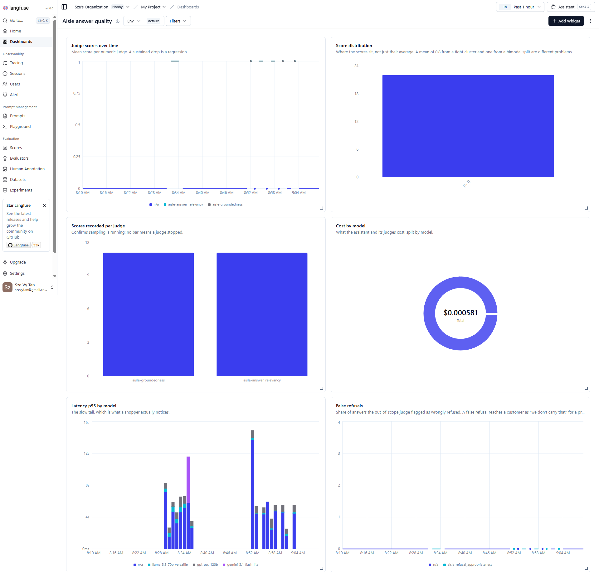
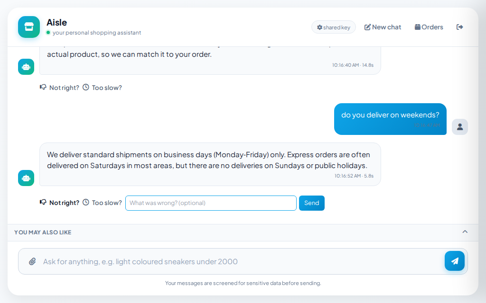
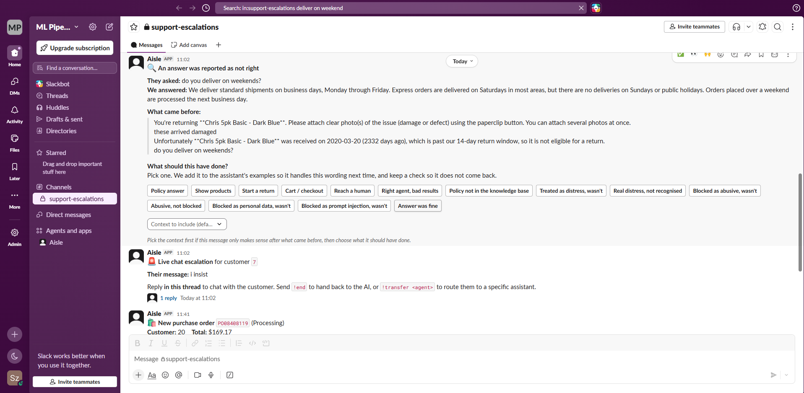

# Evaluation

## The suite
The evaluation suite independently scores five tiers: retrieval, intent classification, answer groundedness and relevance, latency and token usage, and the recommender system. Each tier generates a banded report with performance thresholds established against measured historical baselines. The suite executes on an automated schedule, commits the resulting report to the repository, and sends an alert to the team channel if any metric falls outside its designated band. Modifications to prompts trigger a pull-request comment displaying the baseline and updated scores, as standard unit tests mock all language model calls and cannot evaluate prompt quality changes.

The offline evaluation tier executes without calling external language models, invoking retrieval, tool lookups, and guardrails directly; this design ensures the process is fast, deterministic, and unaffected by external API performance fluctuations. This offline tier evaluates 27 retrieval queries, including three off-catalogue queries that must return zero results, which verifies the refusal path because vector retrievers always return nearest neighbors and will otherwise match irrelevant items like "a lawnmower".

The suite generates a banded report during every execution, pairing each metric with its corresponding threshold and the action required by its current band to ensure the report is self-contained. Recommender metrics are included in the report only when the backtest artifact is present, and they are omitted if that specific tier did not execute.

The evaluation harness enforces a strict rule: if all model providers are rate-limited and the system uses the offline fallback to generate answers, **no score is recorded**. Scoring the fallback mechanism would produce metrics that do not reflect the performance of the model under evaluation.

This rule also applies to retrieval; if the cross-encoder is unavailable and search falls back to lexical rescoring, the report documents this fallback state instead of presenting the resulting score as a valid measurement of the primary ranking stack.

---

## Retrieval

Retrieval performance is evaluated using a dedicated golden dataset of 111 queries: 101 target specific products or attribute families, and ten are off-catalogue and must return zero results. The primary metric is **hit-rate@8**, which measures whether the target product appears within the eight product cards displayed to the user. This metric represents the user experience, as shoppers scan the product grid simultaneously, making a product in the fourth slot as effective as one in the first slot, whereas a product excluded from all eight cards cannot be purchased.

Mean reciprocal rank was previously reported but has been removed because it evaluates result *ordering*, which is not critical for this grid interface, and its denominator included the off-catalogue queries that cannot yield results, artificially capping a perfect score at 0.89 against a threshold that assumed 1.0 was achievable.

## Latency and cost

Every conversational turn records end-to-end latency, the total number of model calls, and token consumption categorized by provider. The report categorizes p50 and p95 latency into bands against thresholds derived from empirical baselines rather than theoretical targets, where a p50 latency of 3s or less is acceptable and 6s represents the threshold of noticeable user delay.

## Judges on live traffic

Three large language model judges evaluate a 15% sample of production responses, measuring **groundedness** (whether the products provided to the assistant support every claim), **answer relevance**, and **refusal appropriateness** (whether the system incorrectly refused a query for an item that the store actually stocks). These judges are defined via configuration files and executed by a script, allowing the evaluation rubric, sampling rate, and thresholds to be reviewed through version control diffs rather than a graphical dashboard. The judge scores and customer ratings use an identical 0-1 scale, enabling direct comparison and joint plotting on the same visualization.

Each judge evaluates a single specific API call rather than the entire execution trace. Because every model call in the execution graph is logged under its provider class, directing a judge to evaluate "any model call" would cause it to analyze routing decisions as frequently as final answers; since routing calls lack product context, this would incorrectly result in a groundedness score of zero. The specific model call containing the final response is named `aisle-answer`, and the judges filter their inputs to target only this identifier.

The refusal judge requires the raw user query, but the prompt sent to the model is a single concatenated string containing instructions, retrieved products, and the user question. To isolate the query, the judge extracts the user question from the metadata of the call rather than the raw input, which would otherwise present the entire system prompt as the final user message.

The dashboard below displays the real-time metrics from these judges, captured via Langfuse over a one-hour period of production traffic. During this period, both numeric judges recorded scores of 1.0 for all evaluated answers, the refusal judge remained at zero indicating no valid products were incorrectly refused, and the middle-right panel displays the total model cost for that hour, which was $0.000581.

## The recommender
The customer segmentation methodology, its seven constituent features, and the overlap between segments are detailed in [Customer segmentation](architecture.md#customer-segmentation).

**The metrics used to evaluate system performance are behavioral rather than geometric.** These metrics are recorded per surface and per algorithm within identical display slots, allowing direct, unbiased comparison of two algorithms operating in the same recommendation rail:

| Metric | Question it answers |
|---|---|
| Click-through rate | What proportion of displayed product cards were selected by users |
| Impression to cart-add conversion | What proportion of displayed product cards resulted in a cart addition |
| Order value | What is the average order value, segmented by whether the basket contained a recommended item |

The first two metrics are directly attributable because every impression, click, and cart addition is logged with the specific surface and generating algorithm, allowing performance changes to be traced to a specific ranking strategy rather than general traffic fluctuations. The third metric measures correlation and is documented as such in the codebase, as users who interact with recommendations typically exhibit a higher baseline purchase intent. Establishing a causal relationship requires a dedicated holdout group and a larger volume of traffic than is available in the demonstration environment.

**Slot allocation is automated.** The two cross-sell algorithms are not allocated static shares of the recommendation rail; instead, `app/grid_allocator.py` queries the cart-addition rates per source from shared counters and dynamically reallocates slots every 15 minutes. The allocation logic prioritizes cart additions over clicks, because a click indicates thumbnail appeal whereas a cart addition validates the relevance of the recommendation. Three constraints prevent the allocation algorithm from adapting to statistical noise:

- Each active source maintains a minimum allocation of 20% of the slots, ensuring that a low-performing source is not starved to zero and can continue collecting the data required for potential recovery;
- Conversion rates are ignored for sources with fewer than 200 impressions, preventing high-variance metrics such as a 33% conversion rate derived from a single cart addition out of three impressions;
- Allocation weights adjust by a maximum of 10 percentage points per recomputation interval, preventing low-traffic periods from causing extreme shifts in the distribution.

The allocation weights are stored in Redis under a single key, ensuring that application replicas allocate slots identically and that the learned state persists across system restarts.

**Offline evaluation scores establish a performance floor rather than the primary optimization objective.** The deployed ranking configuration was selected based on grid differentiation, which maximizes the number of unique products across the four segment grids and minimizes the maximum overlap between any pair of grids. Recall@8 evaluated on a 28-day holdout dataset was insufficient for selection, as all candidate blends within the tested range produced scores within a single standard error of one another. This metric is retained because it detects the inverse failure mode, where optimizing solely for lift maximized differentiation but caused a five-fold reduction in recall by surfacing highly distinctive but low-demand items. Both differentiation metrics are bounded, ensuring that any retraining run that collapses segment diversity by recommending identical bestsellers triggers an alert in the team channel; recall metrics alone cannot detect this regression because uniform grids predict holdout purchases with the same accuracy as highly differentiated grids.

These scores are calculated within the training repository (`aisle-recommender`) by `scripts/backtest_recall.py` using the uncapped transaction log instead of the published order artifacts, which are capped at three order-days per customer for the Orders page and would introduce bias into a train-holdout split. A weekly scheduled job publishes `recsys_scores.json` to this repository, allowing the evaluation tier to process a concrete artifact instead of bypassing the step.

---

## Human feedback loop

Every generated response includes interactive feedback options labeled **Not right?** and **Too slow?**.

Submitting a report generates a triage message in the team channel displaying the conversation history preceding the feedback, accompanied by interactive options for each potential failure mode. Selecting a failure mode appends a training example to the classifier dataset, paired with the specific conversational turn under evaluation. A feedback report indicating an incorrect response is ineffective for debugging without the corresponding user query that generated it. The reported case is also added to the evaluation dataset, ensuring that subsequent fixes are validated against diverse, unlisted phrasings rather than overfitted to a single input. A **Too slow?** submission posts to the same channel with the measured latency, the user query, and the generated response, converting subjective latency complaints into structured performance data.

The **What came before** context block is critical for making the feedback report actionable. In this example, a delivery-related query was reported as incorrect, although the standalone response appears accurate. The preceding conversational turns reveal that the user had just been informed that their return fell outside the 14-day window, indicating a distinct complaint expressed with similar phrasing. Without this historical context, the report would consist only of an isolated sentence and a negative rating.

The same channel aggregates all other operational traffic, including live escalations that team members can resolve in-thread and notifications for each new order.

---

[← Back to the README](../README.md)