# What Aisle does

## Finds and sells products by conversation

Users query the system using natural language. The application searches a product catalog of 3,000 products (including sizes, stock levels, and images) and returns an interactive product grid. Users can select sizes, add items to their cart, and complete checkout directly within the chat interface. The application calculates order totals programmatically, and processes payments via a live payment API in test mode upon user confirmation.

The assistant answers with what it actually has. Asked for something the shop does not sell, it says so instead of inventing a listing.

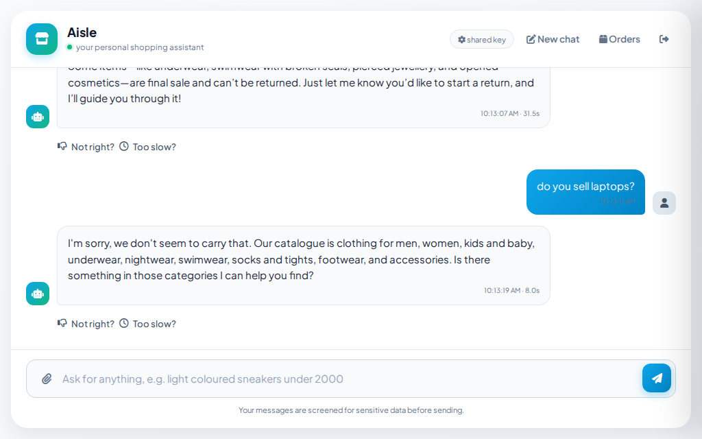

Inventory management is tracked per size. Adding an item to the cart reserves the stock, completing checkout commits the purchase, and abandoning the cart releases the reservation. Concurrency controls prevent multiple users from purchasing the same remaining item. For example, purchasing the Speedy jumpsuit in size XS decrements its stock from 25 to 24, while other sizes and products remain unaffected.

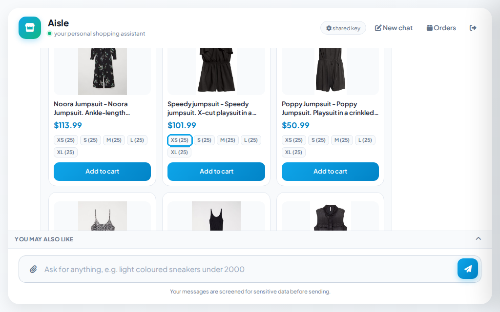
 <b>Before:</b> Stock level for size XS is 25.

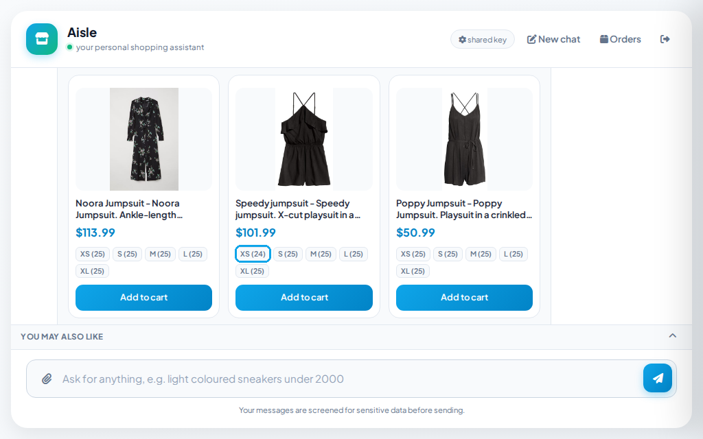
 <b>After checkout:</b> Stock level for size XS decrements to 24. Other sizes remain unchanged.

Users can manage their cart (adding, viewing, removing items, or clearing the cart) entirely through natural language.

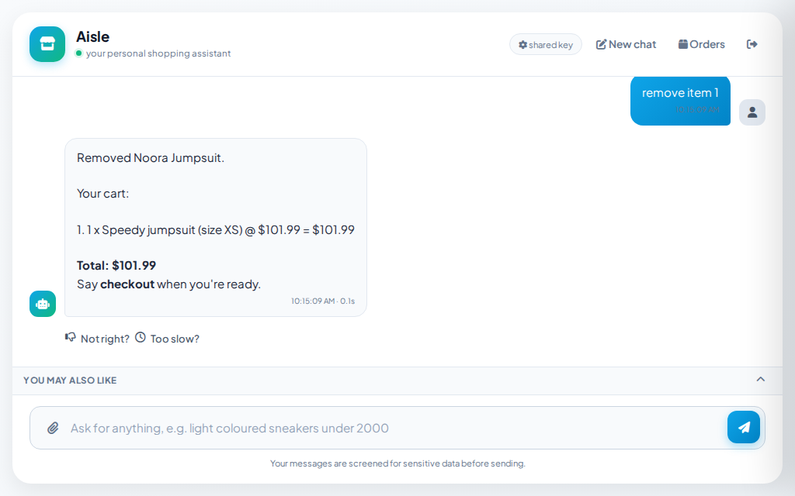

## Handles everything after the sale

The system manages post-sale workflows, including orders, cancellations, returns, policy inquiries, and human agent handoff. The Orders page displays the complete order history, including product images, fulfillment statuses, and financial totals.

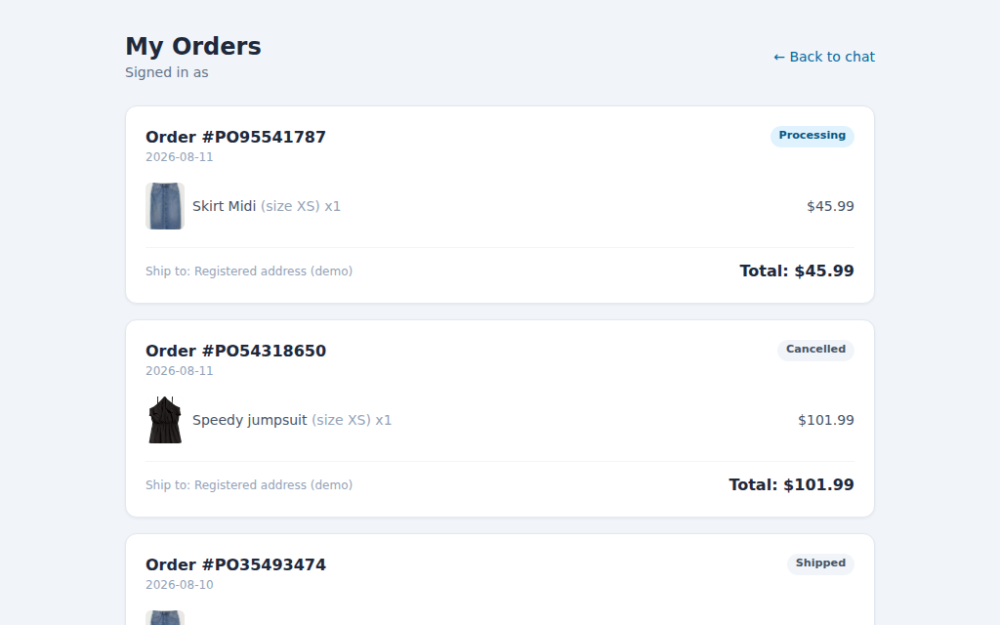

Business logic is enforced deterministically in application code rather than delegated to the LLM. The LLM classifies user intent (such as requesting a return), while the application code determines the valid state transitions. For example, requesting a return for an unshipped order does not enter the photo-verified return flow: the app explains the order has not shipped and offers cancellation instead, itemised with prices. The customer can tap single items to cancel just those, or confirm cancelling the whole order; nothing irreversible happens without that explicit confirmation, the same human-in-the-loop rule the checkout uses.

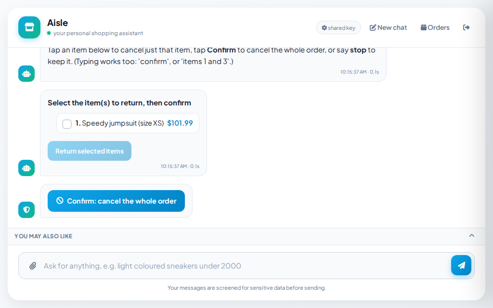

Delivered orders follow the standard return workflow. Returns require photo evidence of defects, must occur within a 14-day window, and restock items upon approval. A vision model validates each uploaded photo. The system rejects images that do not contain the product, show no visible defects, or display a different item. If image validation fails, the system prompts the user to re-upload the photo.

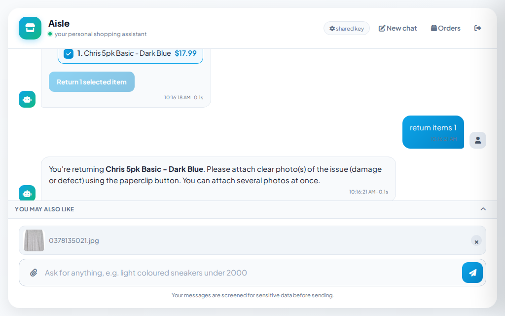

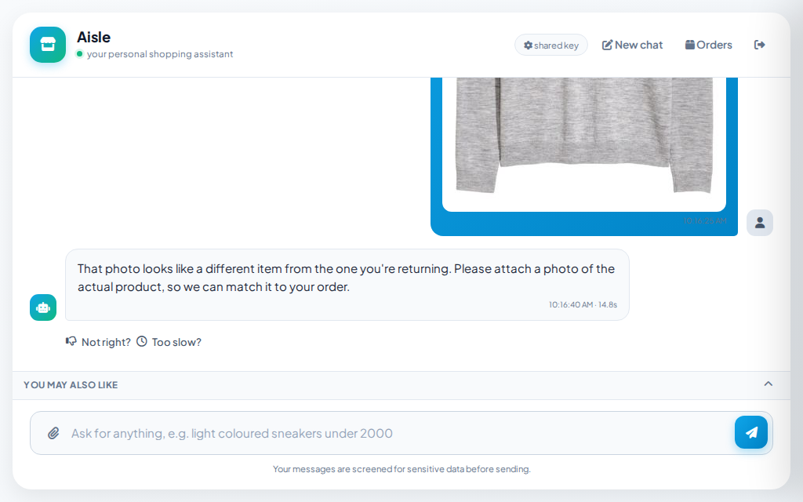

Policy queries are resolved using Retrieval-Augmented Generation (RAG) from official policy documents to prevent hallucinations.

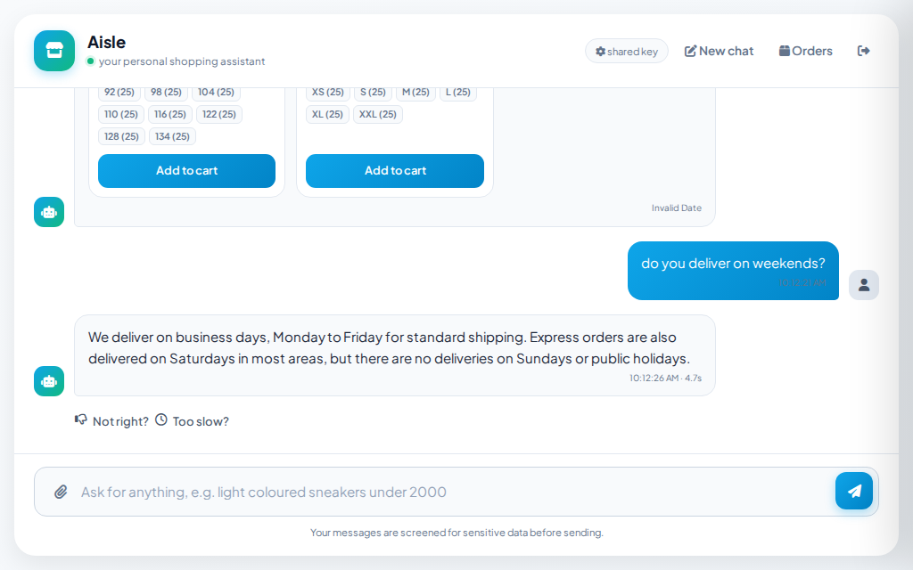

Users can execute account management tasks, such as password resets, directly within the chat interface.

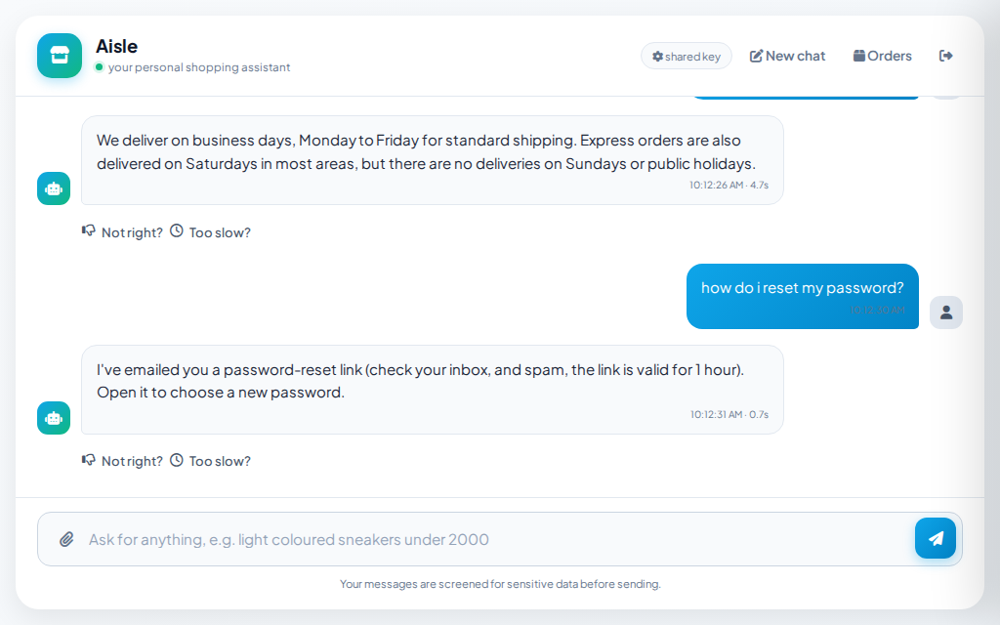

**To minimize operational costs, the assistant attempts self-service resolution before escalating to a human agent.** When a user requests human assistance, the system offers immediate automated support alongside a **Talk to a human** button.

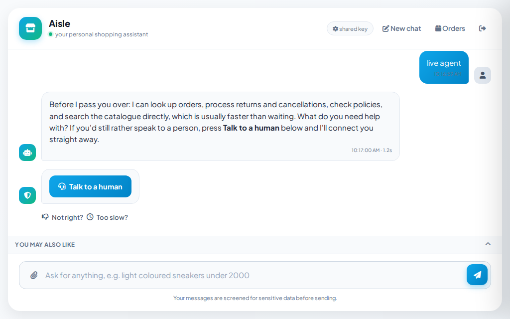

Escalation to the support queue occurs only when the user clicks the button. The intent classifier determines button visibility, while the user's explicit click initiates the transfer. This prevents accidental queuing from false-positive classifications. The button is context-sensitive: sending a different message removes the button, while repeating the request restores it.

Support agents respond via an internal chat tool, and their messages render inline within the customer's chat interface.

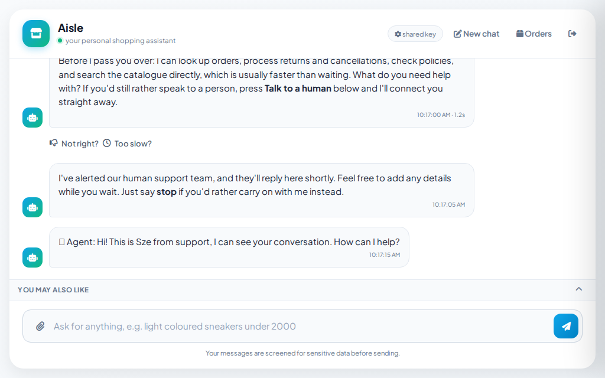

Multi-step workflows display an exit command in the initial message. Users can input this command to terminate the active flow and return to the primary assistant.

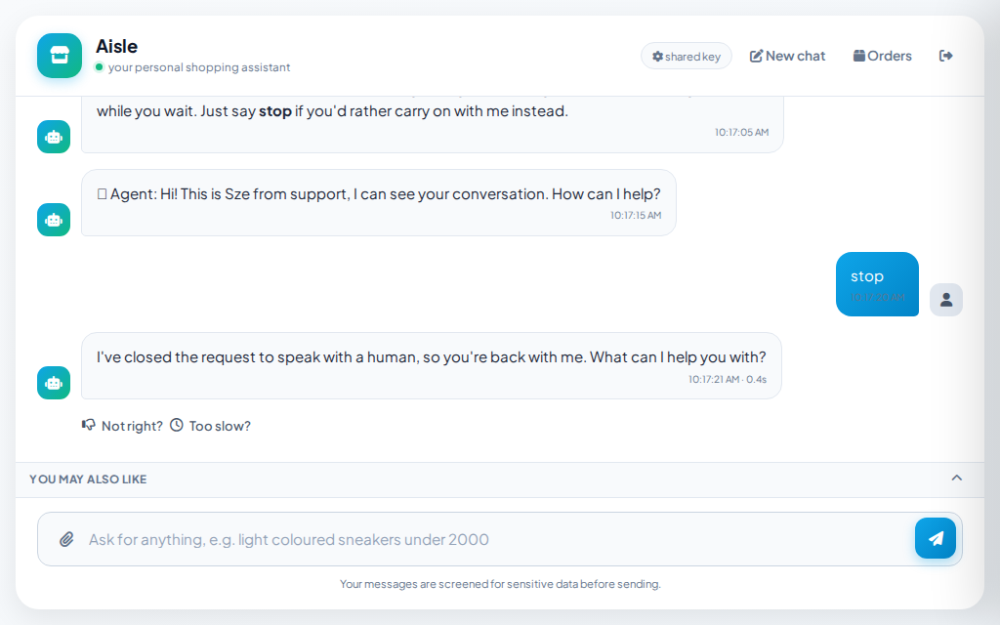

## Knows the shopper and recommends

Personalized recommendations are driven by historical purchase data and evaluated using real-time metrics.

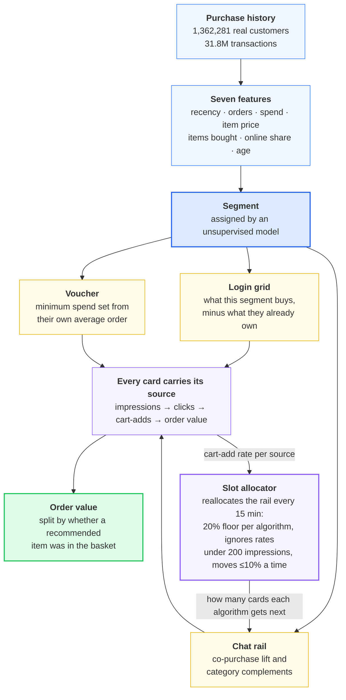

System metrics and their analytical limitations:

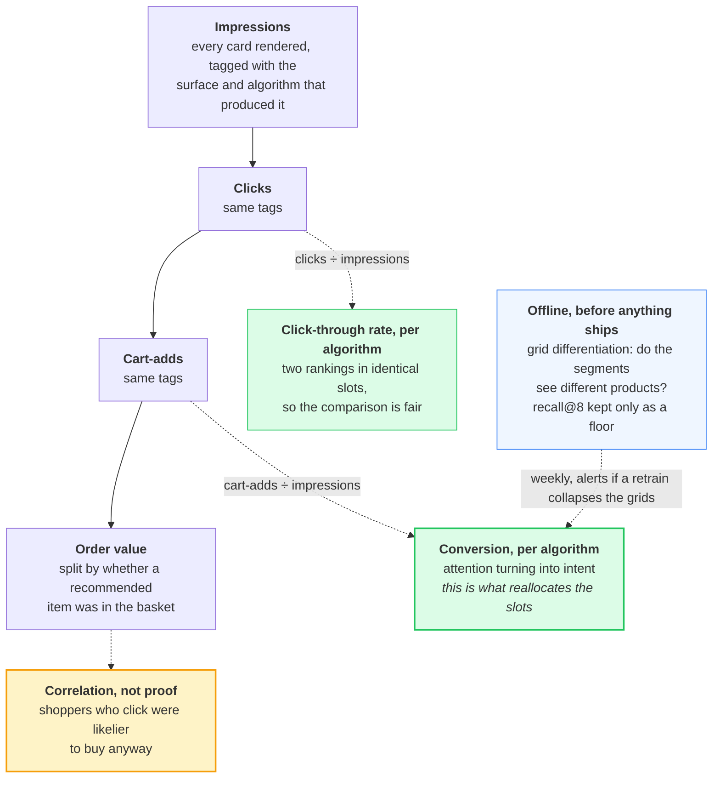

Click-through rate (CTR) and conversion rate evaluate ranking performance. Because recommendation cards are served in identical slots and tagged with their generating algorithm, performance differences isolate algorithmic quality from external variables like seasonal traffic. **The slot allocator optimizes for conversion rate** (defined as cart additions per impression) rather than CTR, as cart additions indicate recommendation relevance. The allocator recalculates allocations every 15 minutes, maintains a 20% minimum allocation floor per algorithm to prevent cold-start starvation, and ignores any rate measured on fewer than 200 impressions, since one cart-add from three impressions is a 33% rate that means nothing.

Average order value (AOV) is tracked similarly but indicates association rather than causation due to self-selection bias. Shoppers enter the "recommended" cohort only by interacting with a recommendation. Because engagement correlates with purchase intent, differences in order value may stem from pre-existing user intent rather than algorithmic influence.

Establishing a causal relationship requires an A/B test where recommendations are withheld from a randomized control group. Randomization ensures group exchangeability, attributing differences directly to the recommendation system. This experiment is not implemented in this project. Additionally, detecting small differences in order value requires tens of thousands of orders per variant to achieve statistical power, which exceeds typical demo traffic. Consequently, this metric serves as a monitoring signal rather than a causal estimate.

**The recommendation objective focuses on incremental value.** Traditional recommenders predict purchase probability, which misclassifies baseline purchases as recommendation successes ([RecSys 2019](https://dl.acm.org/doi/abs/10.1145/3298689.3347018)). Aisle targets **added basket value** to increase average order value. Similarly, promotional vouchers dynamically set minimum spend thresholds based on the user's historical average order value to incentivize larger purchases.

**Telemetry architecture.** The system logs impressions independently across surfaces (login grid, chat search, and recommendation rails). Every click and cart addition is tagged with its source algorithm, and every order records its transaction value. This granular telemetry enables precise, algorithm-specific performance attribution.

Quality metrics are compiled into a structured report generated and committed by a scheduled test suite. Each metric is declared with its threshold, the band that threshold defines, and the action that band implies, so a number requires no second document to interpret:

| Metric | Acceptable | Action when it falls outside |
|---|---|---|
| hit_rate | >= 0.85 | Confirm the vector count matches the catalogue row count. A partial re-ingest is the usual cause. |
| faithfulness | >= 0.80 | The answer contains claims the retrieved passages do not support. Check the grounding prompt before the retriever. |
| p50_latency_s | <= 6.0 | A shopper notices this. Check retrieval time and token counts. |
| p95_latency_s | <= 20.0 | Investigate the tail, usually provider failover waiting on SDK-internal retries. |
| tokens_per_turn | <= 15,000 | Look for a judge retry loop or too high a top_k. Design budget is 10,000. |
| grid_worst_overlap_ratio | <= 0.63 | Two segments show mostly the same products. Check the lift blend (`PICKS_LIFT_ALPHA`) and the candidate pool size. |

Measured values are deliberately omitted. Two conditions prevent the current figures from
describing the system as deployed. Retrieval is scored on 27 queries and groundedness on
5, which is too few to separate a real change from sampling noise. The most recent run
also executed with both reranking stages unavailable, and the report recorded that
condition: `23 queries ran without a cross-encoder, so hit_rate measures the lexical
fallback, not the ranking stack`.

That condition was caused by the suite's own request rate rather than a system fault. The
Pinecone monthly reranking quota was exhausted, and the Voyage free tier permits 3
requests per minute, which 111 sequential evaluation queries exceed within seconds. Live
traffic does not reach that rate because user requests arrive seconds apart. Setting
`RETRIEVAL_SPACING_SEC` paces the run: at 21 seconds between queries, 0 of 5 queries
degraded, compared to 23 of 27 when unpaced.

A perfect retrieval score is also treated as a defect rather than a result. The band
definition for hit_rate above 0.95 reads "suspiciously high; check the expectations are
not query words", because a golden set whose expected answers repeat the search terms is
passed by any retriever.

Historical runs are preserved in `results/eval_report_history.jsonl`, so a metric that
moves between runs appears as a version-controlled diff.

Production telemetry is routed to Grafana dashboards and alerts configured via Terraform, while granular LLM call traces, token usage, and execution costs are sent to Langfuse.

New users must register and complete email verification before receiving personalized content.

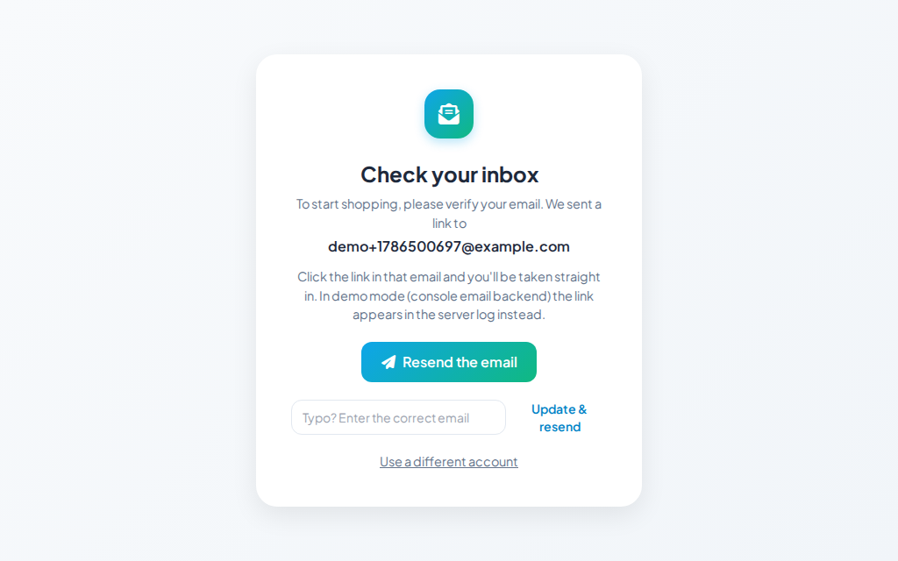

For users without purchase history, the system transparently falls back to demographic-based recommendations, displaying trending items for the user's age group.

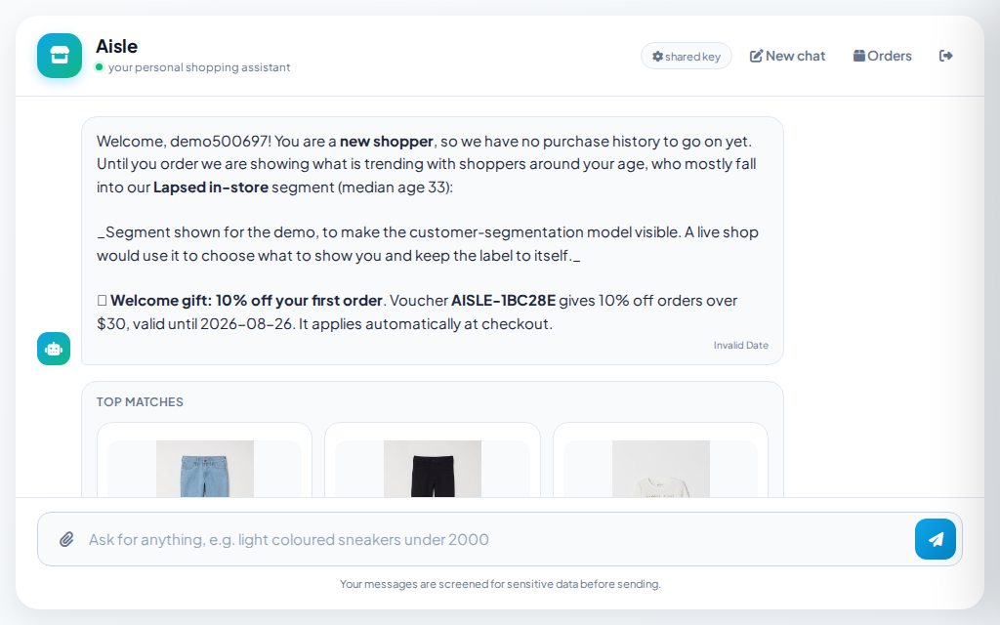

Users can authenticate as any of the 1,362,281 profiles from the [H&M Kaggle dataset](https://www.kaggle.com/competitions/h-and-m-personalized-fashion-recommendations) (accessible via sample profiles on the login page). The personalized interface uses an unsupervised model to assign users to customer segments. The product grid displays items popular within that segment, excluding previously purchased items, and updates weekly.

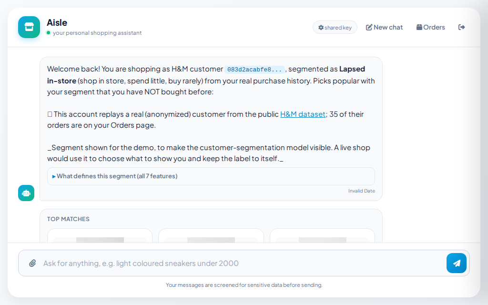

Users can view the underlying features of their assigned segment, comparing their individual metrics against segment medians.

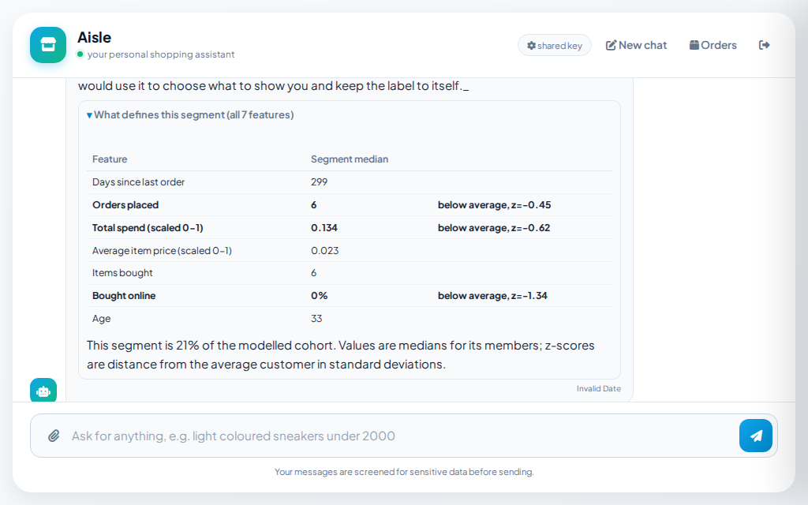

A real-time recommendation rail above the chat input updates based on conversation context. For example, discussing blazers displays items frequently co-purchased with blazers. The rail interleaves recommendations from two algorithms: co-purchase lift and category complements. Each card is tagged to compare CTR and cart-addition rates under identical presentation conditions.

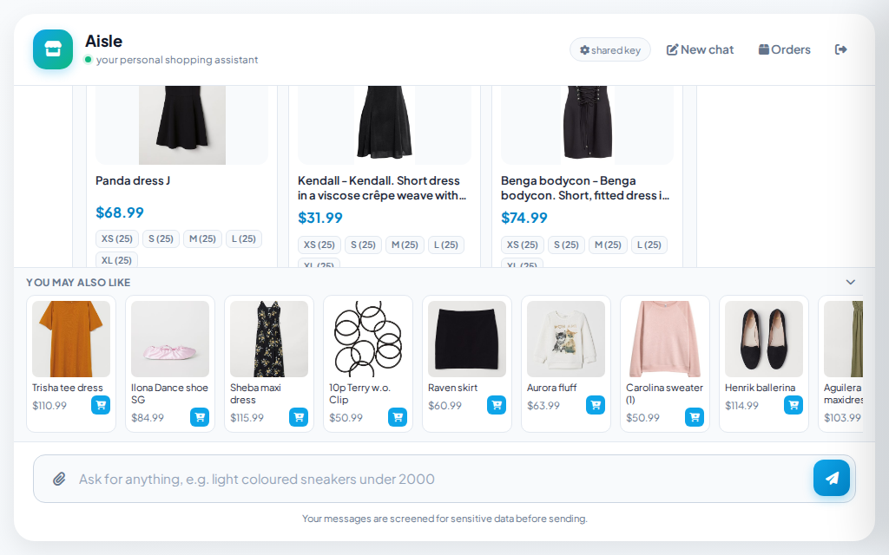

The recommendation rail is collapsible via a header chevron, and the user's preference persists across turns. To maintain metric accuracy, collapsed rails do not log impressions, preventing unviewed cards from skewing CTR calculations.

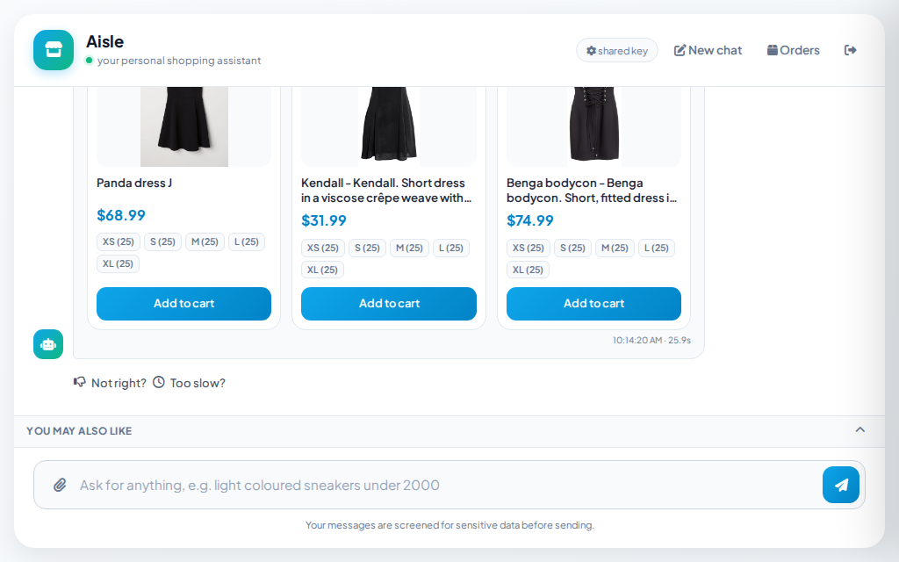

Users can purchase recommended items directly from the rail. Single-size products are added with a single tap, while multi-size products prompt size selection to ensure deliberate user choice.

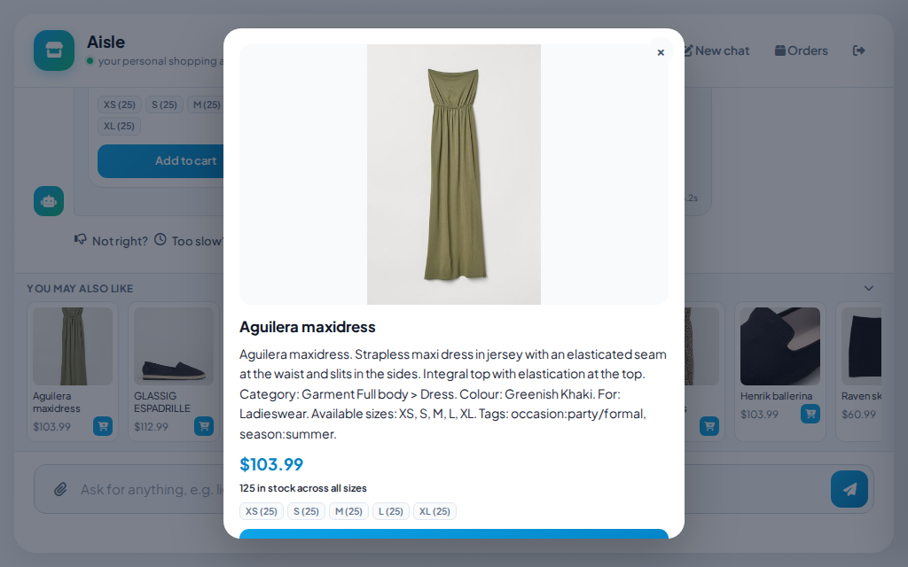

---

[← Back to the README](../README.md)