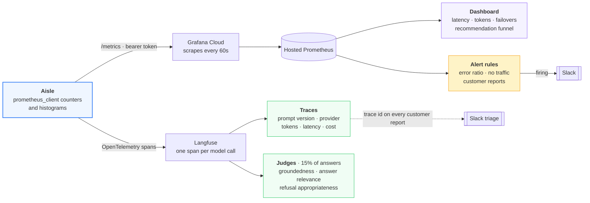
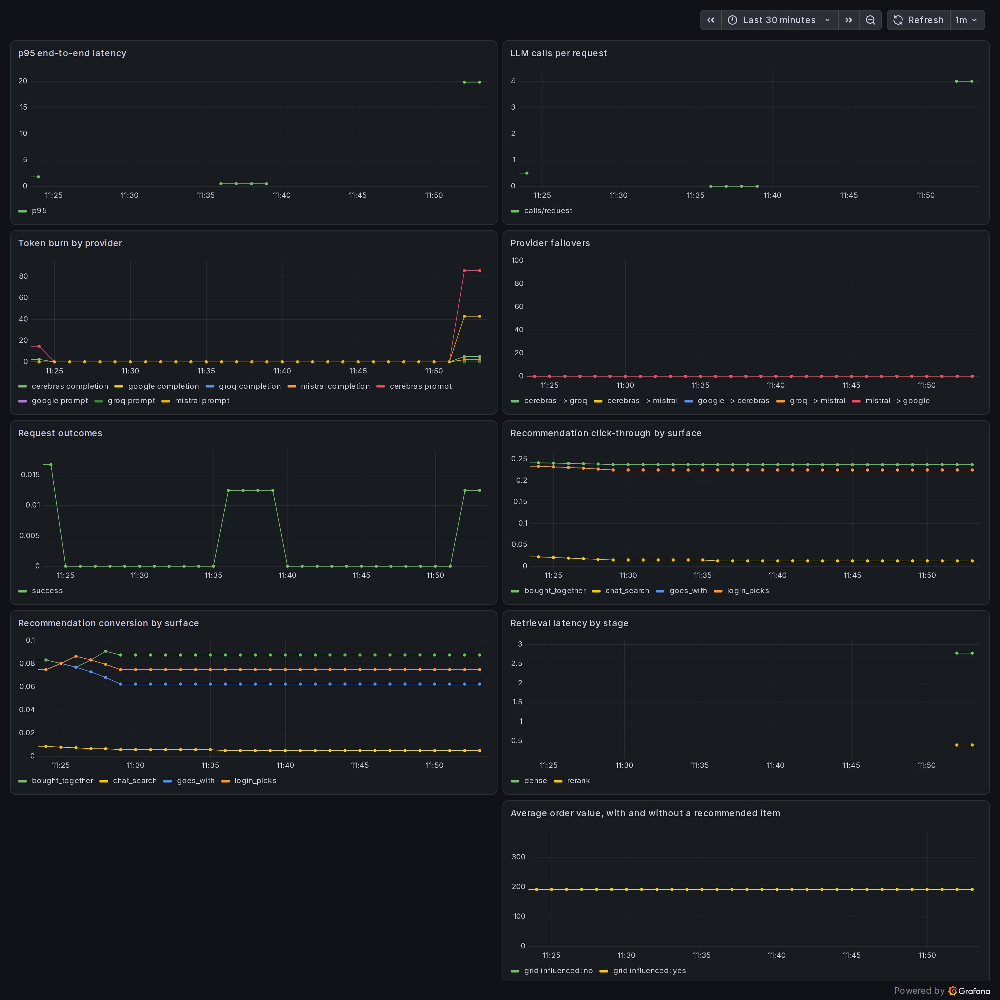

# Observability

The system uses two distinct observability platforms to monitor performance and debug issues.

**Metrics (Prometheus, Grafana).** Nine panels, declared in Terraform:

| Panel | Answers |
|---|---|
| p95 end-to-end latency | Quantifies the latency of the 95th percentile of requests. |
| LLM calls per request | Tracks the number of model calls per request to identify changes in model usage. |
| Token burn by provider | Measures token consumption per provider to monitor budget utilization. |
| Provider failovers | Records the frequency of requests transitioning to a backup provider. |
| Request outcomes | Calculates the ratio of successful requests to failed requests. |
| Retrieval latency by stage | Isolates latency contributions from dense search, BM25, or reranking stages. |
| Recommendation click-through by surface | Measures user attention per recommendation surface. |
| Recommendation conversion by surface | Measures cart-add rates per recommendation algorithm. |
| Average order value, with and without a recommended item | Compares order values to determine the impact of recommendations on basket size. |

The two recommendation panels split every series by a `source` label, so the four
surfaces are compared separately rather than as one number: `bought_together`
(co-purchase pairs scored by lift), `goes_with` (the category complement table),
`login_picks` (the greeting grid) and `chat_search` (what the agent returned for a
query).

The distinction matters because a click means different things on each surface. A click
on a chat result mostly means the search understood the query. A click on an unrequested
suggestion means the recommender surfaced something wanted. One combined rate would
describe neither.

Conversion is the panel that acts. The slot allocator reads cart-adds per impression per
source and reallocates the rail on that number, because a click measures attention while
a cart-add measures intent.

The recommendation panels in this capture show one series each, `chat_search`, because
the other three surfaces recorded no impressions during the window. A source appears on
the chart only once it has served a card.

**Three alert rules, each with a threshold set from measured behavior rather than arbitrary round numbers.**

| Alert | Condition | Waits | Why this threshold |
|---|---|---|---|
| Error ratio above 2% | `sum(rate(chat_requests_total{status="error"}[5m])) / sum(rate(chat_requests_total[5m])) > 0.02` | 10m | Failures below 2% represent isolated timeouts and provider errors absorbed by the failover chain. Higher rates indicate systemic issues. The 10-minute wait prevents transient, self-healing bursts from triggering pages. |
| No requests while healthy | `rate(chat_requests_total[15m]) < 0.0001` | 30m | The web-layer health check remains green even if the chat service fails. This alert detects when the process is running but serving no traffic. The 30-minute window prevents false positives during free-tier idle sleep. |
| Customers reporting wrong answers | `increase(user_reports_total[1h]) > 2` | 15m | A single report may be subjective, but three within an hour indicates a pattern, typically caused by a newly deployed prompt or retrieval change. The alert summary links directly to the relevant traces for immediate debugging. |

Alerts include actionable instructions and post to a dedicated Slack channel separate from customer escalations, preventing on-call notifications from competing with customer support. Notifications are grouped by alert name and repeat every four hours while active.

The Grafana dashboard displays real failover transitions under free-tier rate limits, specifically `cerebras -> groq`, `groq -> mistral`, and `mistral -> google`. The entire monitoring infrastructure (the dashboard, its nine panels, three alert rules, Slack contact point, and notification policy) is defined in Terraform to ensure reproducibility.

The app exposes `/metrics` in Prometheus text format and Grafana Cloud scrapes it every 60 seconds. The interval is 60 rather than the local default of 15 because the free tier bills on series and samples, and these metrics do not move fast enough for 15 seconds to reveal anything 60 hides. The scrape job is a Terraform resource like everything else, and it authenticates with a bearer token, which Grafana Cloud requires: it refuses to scrape an unauthenticated URL.

**Tracing (Langfuse).** Langfuse captures every model call as a span, recording the prompt version, provider, token count, latency, and cost. Customer error reports include the trace id, allowing immediate access to the exact conversation.

LLM judge scores use the same 0-1 scale as customer ratings, enabling direct correlation analysis. Tracing only records execution data; quality evaluation is handled by the judges detailed in [Evaluation](evaluation.md).

---

[← Back to the README](../README.md)