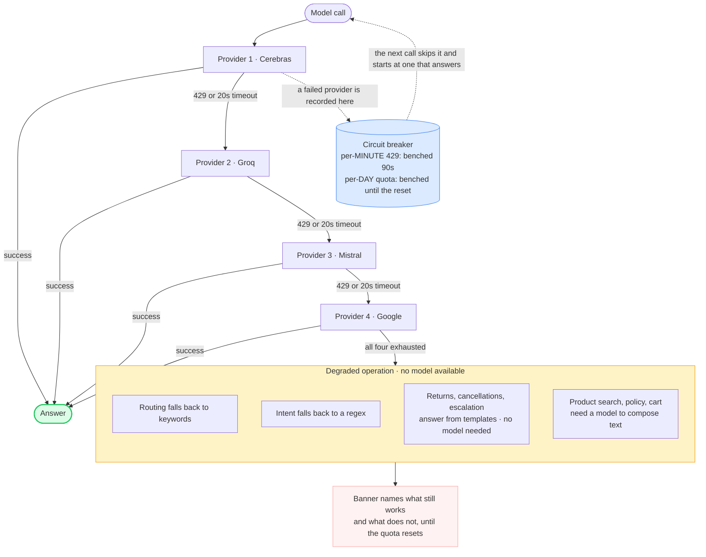
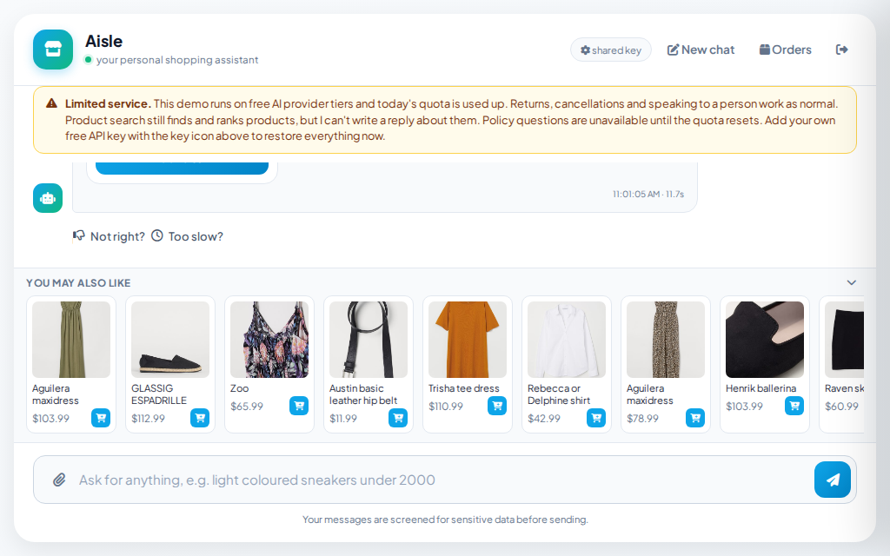

# Reliability

To handle free-tier API limitations, the application degrades gracefully in four stages:

1. **Provider failover:** The system routes requests across four providers, immediately falling over to the next when encountering a rate limit.
2. **Circuit breaker:** Per-minute limits trigger retries within seconds, while daily quota exhaustion pauses requests until the provider's specific reset boundary.
3. **Fail fast:** Request timeouts prevent hung requests by converting stalled provider calls into immediate failovers. Non-retryable errors fail immediately.
4. **Honest degradation:** If all providers are exhausted, the UI displays a banner explaining the limitation rather than serving degraded or silent failures.

## Why there is no exponential backoff on the model call

All provider clients are initialized with `max_retries=0`. While standard practice favors exponential backoff, backoff assumes retrying the same endpoint will eventually succeed. This assumption holds for transient network errors but fails for free-tier rate limits. When one provider is rate-limited, other providers remain idle with available quotas. **Switching is faster than waiting**; the failover chain acts as the retry mechanism. Backoff would only introduce unnecessary latency before an inevitable failure.

This design choice was validated by measurement. Gemini's 429 error includes a `retry_delay` (observed at 57 seconds) that the SDK silently honors twice. With default retries enabled, a rate-limited request stalled for two minutes before failing over. Consequently, product searches took 50 to 61 seconds on 2 August 2026 when all providers were rate-limited. Setting `max_retries=0` ensures an immediate failover to the next provider.

The application pauses in only one scenario: if **all four** providers are rate-limited in a single pass. In this case, the application sleeps once and retries the chain, as per-minute limits resolve in seconds, making a brief delay preferable to a hard failure. Daily quota exhaustion is raised immediately because it cannot resolve quickly.

| Failure | Response | Why not backoff |
|---|---|---|
| One provider 429s | Immediate hop to the next provider | Another quota is available now |
| A provider stalls | 20-second timeout, then hop | A hung socket never recovers on its own |
| All four 429 in one pass | Sleep once, walk the chain again | A per-minute cap clears in seconds |
| A daily quota is exhausted | Raise now, mark the provider down until its reset boundary | Waiting cannot help before the reset |

## Circuit breakers, and what each one protects

Circuit breakers prevent repetitive, predictable failures from wasting user latency.

**Provider breaker:** When a daily quota is exhausted, the system flags the provider as inactive until its specific reset boundary. Subsequent requests bypass the inactive provider, avoiding redundant failure checks.

**Reranker breaker:** Pinecone's monthly rerank limit is 500 requests org-wide. Once exhausted, subsequent calls return 429 errors. The breaker then opens, routing queries directly to Voyage. Measurements show a query takes 0.822s with the breaker closed (probing the exhausted service) versus 0.318s with it open, saving 0.50s per query by avoiding the exhausted provider.

Because the limit resets monthly, a short cooldown is inefficient. A 5-minute cooldown would close the breaker 288 times daily, repeatedly costing users 0.50s to check an un-reset quota. Setting `RERANK_BREAKER_COOLDOWN_SEC` to 6 hours limits probes to 4 times daily, which is sufficient to detect a reset while minimizing latency overhead.

The two reranking stages have distinct failure modes and limits:

| Stage | Limit | Recovers |
|---|---|---|
| Pinecone rerank | 500 per month, org-wide | When the month rolls over |
| Voyage rerank | 3 requests per minute on the free tier | Within seconds |

Voyage enforces a rate limit rather than a hard quota, allowing normal, spaced user traffic to pass. However, concurrent requests from the evaluation suite exceed this limit. Because the suite executes retrieval queries back-to-back, most queries fall back to lexical ordering. The suite logs these occurrences and labels the evaluation scores accordingly, ensuring burst-induced fallbacks do not skew the measured quality of the ranking stack.

Fallback and recovery paths are thoroughly tested to ensure system stability during active failures.

When all LLM providers are exhausted, the application degrades to a defined subset of features. Routing falls back to keyword matching, and intent classification falls back to regular expressions. Common workflows (returns, cancellations, and human agent routing) use static templates and bypass the LLM entirely. Product search retains its full retrieval stack: the vector index embeds queries server-side, the BM25 keyword search runs locally, and the reranker operates as an independent service. The exhausted quota only disables the LLM-generated conversational response and conversational follow-up resolution. Consequently, the product grid displays under a static "Closest matches" label instead of custom prose. Policy questions, which require LLM generation, display a message indicating quota exhaustion and the expected reset time. The UI banner explicitly details this limited-service state.

The screenshot below demonstrates the application operating under complete daily quota exhaustion, showing the active limited-service banner above a functional, interactive product grid.

---

[← Back to the README](../README.md)