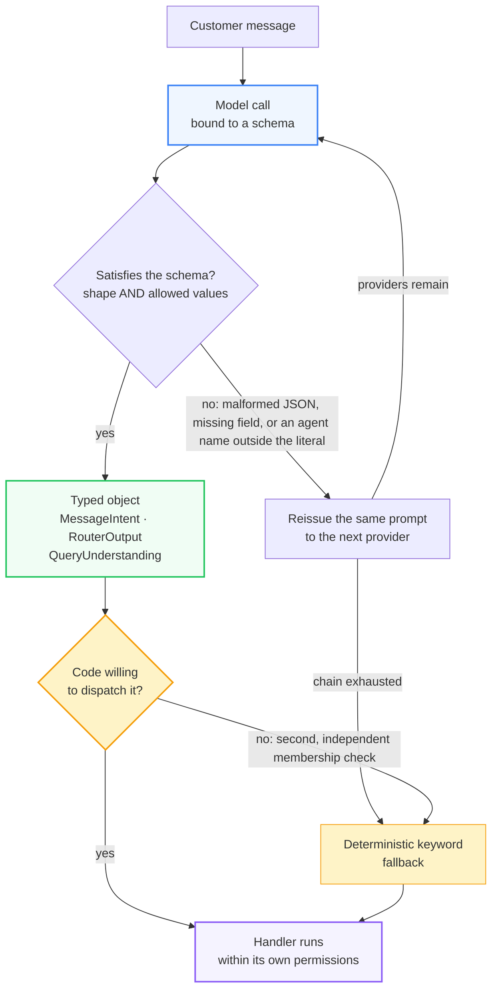

# Structured output enforcement

Four model decisions drive control flow. Each uses a Pydantic schema to ensure handlers receive typed objects with guaranteed fields. No component uses regular expressions or substring tests to parse model responses. This validation also applies at the HTTP boundary, where request bodies are checked before handler execution.

| Schema | Runs when | Fields, and what each one controls |
|---|---|---|
| `MessageIntent` | every customer message | Nine booleans: `wants_return`, `wants_cancel`, `wants_human`, `frustrated`, `distress`, `abandon`, `asks_about_service`, `is_abusive`, `is_smalltalk`. The router and agents use these instead of re-reading the message. |
| `RouterOutput` | every customer message | `agent`: The agent handling the turn. Typed as a Literal of the six registered names to prevent invalid agent selection. |
| `QueryUnderstanding` | before a catalogue search | `in_catalogue`: Boolean for catalogue relevance. `search_terms`: A 2-5 word product phrase with filler removed and terminology normalized. `category`: A catalogue category or empty if the request spans multiple. |
| `ReturnPhotoAssessment` | when a photo is attached to a return | `shows_product_issue`: Boolean for issue detection. `issue_type`: One of damage, defect, wrong_item, used_or_worn, not_visible, unrelated_image. `severity`: none, minor, moderate or severe. `description` and `recommendation`: Textual analysis for the return agent. |



Three properties of this path are enforced in code.

**Schema violations are recoverable faults.** A validation failure raises a `ValidationError`, which the provider chain treats as transient. The system reissues the prompt to the next provider. If the chain is exhausted, intent classification falls back to deterministic keyword matching to ensure cancellations and handoffs function during provider outages.

**Permitted values are declared in the schema.** `RouterOutput.agent` is typed as a Literal of the six registered agent names. The emitted JSON schema includes an `enum` of these names, which constrains decoding at the provider level. Invalid names are rejected during validation rather than downstream.

**A valid response is checked before use.** While the schema guarantees the router returned one of the six agent names, it does not guarantee the selection is correct. `router_node` verifies the name against `VALID_AGENTS` before dispatching. If the check fails, the system routes by keyword. The schema constrains model output, while the code controls system execution.

## The same contract at the HTTP boundary

The application uses FastAPI to validate the request body against a Pydantic schema before any gate or agent runs. `ChatRequest` defines four fields: `query` (string), `images_b64` (list of strings), `image_b64` (string), and `stream` (bool). The system ignores unknown fields and rejects incorrect types with a 422 error specifying the field.

```json
{"error": "invalid request", "detail": "query: Input should be a valid string"}
```

This validation prevents silent coercion bugs. Previously, `images_b64` sent as a string was iterated character by character, creating fake one-letter images and misrouting the turn. Boundary validation converts these client errors into immediate, named responses rather than allowing corrupted behavior downstream.

Model output and request input follow the same rule: handlers only receive objects with a verified shape, regardless of whether the sender is a language model or a browser.

---

[← Back to the README](../README.md) · [Architecture](architecture.md)