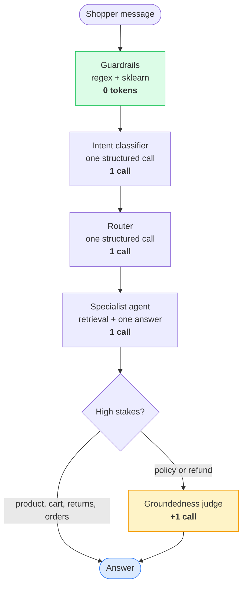

# Token economics

Every answer consumes tokens. On free provider tiers, the budget is a hard limit. The design target is at most 6 model calls and 10,000 tokens per shopper message. The performance tier of the evaluation suite measures an average of 2.9 calls and 5,742 tokens per query, with 10 of 10 checks passing.

We measure these figures to prevent cost creep. Each model call records input and output tokens to a Prometheus counter labeled by provider and type. Langfuse tracks these figures per trace, allowing for granular inspection of expensive turns.

## Where the budget goes on one message

The guardrail layer uses pattern matching and a small sklearn model, consuming zero tokens. Abusive or injected messages are rejected before calling any provider, ensuring the lowest cost for malicious inputs.

## What holds the number down

**One classification per turn.** Intent is classified once and stored in the state. Subsequent nodes read this result rather than re-evaluating. This replaces the previous approach where three components independently classified messages, causing redundant calls and inconsistent results.

**Utility providers for simple tasks.** Classification and routing use short, structured calls to a separate utility provider, preserving the primary quota. Routing does not require the high-capacity model used for generating answers.

**Strict retrieval limits.** Policy answers retrieve 3 passages (chunked at 1,600 characters when the knowledge base is indexed). The product grid shows 10 candidates, chosen by reranking a 25-candidate pool. We tune `top_k` against the evaluation suite rather than setting it high for convenience, as it directly multiplies token costs per RAG turn.

**Output cap of 800 tokens.** This limit ensures the groundedness judge can process the entire answer within its per-minute token limit.

**Tool loop limit of 6 iterations.** Both tool-calling agents terminate after 6 iterations to prevent budget exhaustion and ensure system safety.

**Targeted groundedness checking.** The judge runs only on policy answers, as defined by `EVALUATOR_SCOPE`. Product answers are excluded because they rely on catalogue data and prompts that forbid invention. Cart totals and order statuses are derived from code, making model-based verification redundant.

**Efficient regeneration.** When the judge rejects an answer, the retry includes only the latest draft and the judge's feedback. This prevents the prompt from growing during the most expensive turns.

**Non-model data retrieval.** Product search uses a vector index and a local BM25 implementation. Segment assignment, picks, vouchers, and cart totals are calculated via arithmetic on data artifacts. These operations consume zero tokens.

## Design for first-attempt success

We prioritize first-attempt success to avoid the cost of regeneration, which roughly doubles the expense of a turn. The generator is grounded in retrieved passages and uses the catalogue's vocabulary to ensure quality and cost efficiency.

## What is measured, and where to look

| Signal | Where | What it answers |
|---|---|---|
| Tokens per call, by provider and kind | Prometheus counter, Grafana panel | Is the average creeping up after a prompt change? |
| Calls and tokens per query | Evaluation suite, performance tier | Is a change still inside the 6-call, 10,000-token target? |
| Per-trace breakdown | Langfuse | Which call made this particular turn expensive? |

Regressions are identified by monitoring these metrics. The performance tier runs on a weekly schedule alongside quality tiers, ensuring that prompt changes increasing token usage are caught during standard validation.

---

[← Back to the README](../README.md)